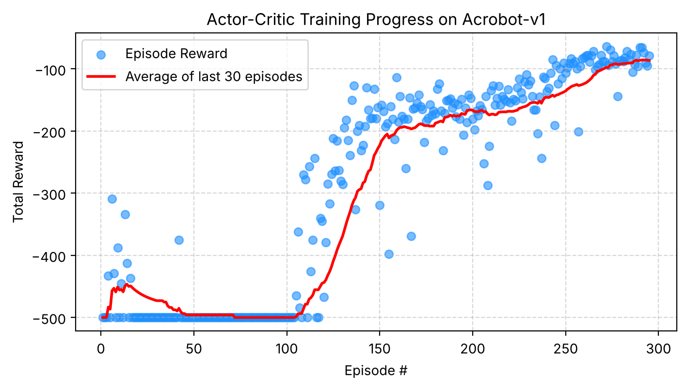
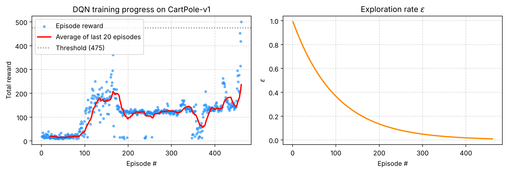
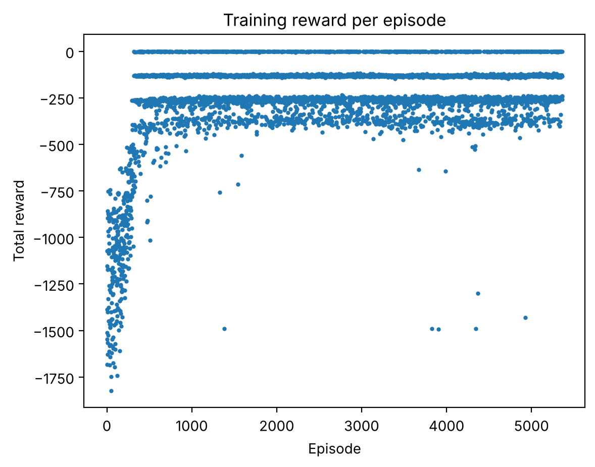
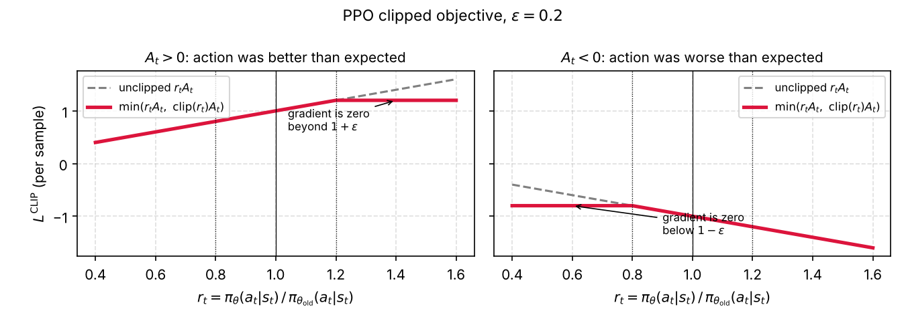

# ARF-3 Algorithms: A2C, DQN and PPO

Three small reinforcement-learning implementations in PyTorch and [`gymnasium`](https://gymnasium.farama.org), written as [marimo](https://marimo.io) notebooks. Each one was run end to end and exported to static HTML (code, maths, plots and an animation of the trained policy), published through GitHub Pages.

| Notebook | Algorithm | Environment | Actions | Result of the rerun | Static HTML |
|---|---|---|---|---|---|
| [`Acrobot_A2C.py`](Acrobot_A2C.py) | Advantage actor-critic | `Acrobot-v1` | discrete (3) | solved at episode 295, greedy score −87.03 (threshold −90) | [**view**](https://truecp6.github.io/ARF-3-Algorithms/Acrobot_A2C.html) |
| [`DQN.py`](DQN.py) | Deep Q-network | `CartPole-v1` | discrete (2) | solved at episode 461, greedy score 478.89 ± 54.23 (threshold 475) | [**view**](https://truecp6.github.io/ARF-3-Algorithms/DQN.html) |
| [`PPO_v2.py`](PPO_v2.py) | Proximal policy optimisation | `Pendulum-v1` | continuous (1) | solved in 524 update cycles (≈1.07 M steps), training mean −144.6 (threshold −150), greedy score −185.1 ± 93.8 | [**view**](https://truecp6.github.io/ARF-3-Algorithms/PPO_v2.html) |

The three notebooks form a progression: **DQN** learns action *values* from replayed experience, **A2C** learns a *policy* directly from a stream of single transitions, and **PPO** learns a policy from large reused batches while a clipped objective keeps each update small and extends it to continuous actions.

Throughout, $\gamma$ is the discount factor and $d$ is the *terminated* flag. A time-limit *truncation* is not a failure, so it still bootstraps from the next state's value.

---

## 1. Acrobot with A2C

[Interactive page](https://truecp6.github.io/ARF-3-Algorithms/Acrobot_A2C.html) · [source](Acrobot_A2C.py)

<table>
<tr>
<td></td>
<td></td>
</tr>
</table>

**Task.** A two-link pendulum hangs from a pivot and only the joint between the links is driven, with torque $\tau \in \{-1, 0, +1\}$. The state is $s = (\cos\theta_1, \sin\theta_1, \cos\theta_2, \sin\theta_2, \dot\theta_1, \dot\theta_2) \in \mathbb{R}^6$. The reward is $-1$ per step until the free end swings above the line, so a return close to $-500$ means "never made it" and a return near $-80$ is close to optimal. The run is solved when the 30-episode average and 100 greedy episodes both reach $-90$. The curve shows the long plateau at $-500$ before the first swing-ups are discovered around episode 105, then a steady climb.

**Method.** The actor is $\pi_\theta(a\mid s) = \mathrm{softmax}(f_\theta(s))$ and the critic is a state-value baseline $V_\phi(s)$ (both $6\to64\to64\to$ output, ReLU). After **every** transition, with no replay buffer:

$$y = r + \gamma\,(1-d)\,V_\phi(s'), \qquad A(s,a) = y - V_\phi(s)$$

$$\mathcal{L}_{\text{critic}} = \big(V_\phi(s) - y\big)^2, \qquad \mathcal{L}_{\text{actor}} = -\ln\pi_\theta(a\mid s)\;\mathrm{sg}\big[A(s,a)\big]$$

where $\mathrm{sg}[\cdot]$ is stop-gradient. This is the policy-gradient estimator $\nabla_\theta J = \mathbb{E}\big[\nabla_\theta \ln\pi_\theta(a\mid s)\,A(s,a)\big]$ with the critic as a variance-reducing baseline. The critic learns faster than the actor (Adam, learning rates $10^{-3}$ vs $10^{-4}$), so the advantage it supplies is reliable by the time the actor leans on it. The notebook's prose writes the critic loss as $\tfrac12 A^2$; the code uses `F.mse_loss`, i.e. without the $\tfrac12$, a constant factor that Adam largely absorbs.

---

## 2. Cart-Pole with a Deep Q-Network

[Interactive page](https://truecp6.github.io/ARF-3-Algorithms/DQN.html) · [source](DQN.py)

<table>
<tr>
<td></td>
<td></td>
</tr>
</table>

**Task.** A pole is balanced on a cart that can be pushed left or right. The state is $s = (x, \dot x, \theta, \dot\theta) \in \mathbb{R}^4$ and the reward is $+1$ for every step the pole stays up, capped at 500 steps, so the best possible return is 500. It counts as solved at 475. The left panel shows the cart exploring at random (returns near 20), discovering balancing around episode 100, then plateauing near 120 before finally reaching the maximum at the end; the right panel shows $\epsilon$ decaying from 1 towards its floor.

**Method.** The network $Q_\theta(s,\cdot)$ ($4\to64\to64\to2$) is trained to satisfy the Bellman optimality equation $Q^*(s,a) = \mathbb{E}\big[r + \gamma\max_{a'}Q^*(s',a')\big]$ by regression on mini-batches of 64 transitions sampled at random from a 10 000-entry replay buffer $\mathcal{D}$:

$$y = r + \gamma\,(1-d)\,\max_{a'} Q_{\theta^-}(s', a'), \qquad \mathcal{L}(\theta) = \mathbb{E}_{(s,a,r,s',d)\sim\mathcal{D}}\Big[\big(Q_\theta(s,a) - y\big)^2\Big]$$

Two devices keep this regression stable. Sampling from the **replay buffer** breaks the correlation between consecutive steps. A **target network** $\theta^-$, a frozen copy of $\theta$ refreshed every 500 steps, stops the target $y$ from moving with every gradient step. Behaviour is $\epsilon$-greedy, taking a random action with probability $\epsilon_k = \max(0.01,\ 0.99^{k})$ after $k$ episodes, and $\epsilon=0$ for evaluation. Adam with $\gamma = 0.99$, learning rate $10^{-3}$.

---

## 3. Pendulum with PPO

[Interactive page](https://truecp6.github.io/ARF-3-Algorithms/PPO_v2.html) · [source](PPO_v2.py)

<table>
<tr>
<td></td>
<td></td>
</tr>
</table>

**Task.** Swing a torque-limited pendulum up and hold it upright. The state is $s = (\cos\theta, \sin\theta, \dot\theta) \in \mathbb{R}^3$ and the action is a continuous torque $a \in [-2, 2]$. The reward is $r = -(\theta^2 + 0.1\,\dot\theta^2 + 0.001\,a^2)$ with $\theta = 0$ upright, over 200-step episodes, so returns run from about $-1800$ (never lifted) to $0$ (starts upright). Once the agent has learned, returns cluster in bands (about $0$, $-130$, $-250$, $-380$) according to how many swings the random starting angle requires. The notebook is parameterised by environment, so the same code can be pointed at, for example, `BipedalWalker-v3`.

**Method.** The policy is Gaussian, $\pi_\theta(a\mid s) = \mathcal{N}\big(\mu_\theta(s),\ \sigma^2\big)$, with a $\tanh$ network for the mean and a learnable, state-independent $\ln\sigma$ that the agent shrinks as it grows confident. Each cycle collects a 2048-step rollout and then reuses it for 10 epochs of minibatch (64) gradient descent. Advantages come from **generalised advantage estimation** in one backward pass over the rollout:

$$\delta_t = r_t + \gamma V(s_{t+1})(1-d_t) - V(s_t), \qquad A_t = \delta_t + \gamma\lambda(1-d_t)A_{t+1}, \qquad R_t = A_t + V(s_t)$$

where $\lambda$ trades bias (small) against variance (large), and $\lambda = 0$ recovers the one-step advantage of A2C. (Here $d_t$ means terminated *or* truncated, which cuts the advantage recursion at episode boundaries. For a truncated step the notebook adds $\gamma V(s')$ to the reward, which restores the bootstrap.) Because the data was gathered by an older policy, each sample is reweighted by the probability ratio $r_t(\theta)=\exp\big(\ln\pi_\theta(a_t\mid s_t) - \ln\pi_{\theta_\text{old}}(a_t\mid s_t)\big)$, and the update is made pessimistic by clipping it:

$$L^{\text{CLIP}} = \mathbb{E}_t\Big[\min\big(r_t A_t,\ \mathrm{clip}(r_t,\,1-\epsilon,\,1+\epsilon)\,A_t\big)\Big], \qquad \epsilon = 0.2$$

$$\mathcal{L}(\theta) = -L^{\text{CLIP}} + c_v\cdot\tfrac12\,\mathbb{E}_t\big[(V_\theta(s_t) - R_t)^2\big] - c_e\,\mathbb{E}_t\big[\mathcal{H}[\pi_\theta(\cdot\mid s_t)]\big], \qquad c_v = 0.5,\ c_e = 0.01$$

Once the ratio has moved past $1\pm\epsilon$ in the direction that helps, the clipped term has zero gradient, so there is no incentive to move the policy further from the one that collected the data (figure below). The remaining settings are $\gamma = 0.9$, $\lambda = 0.95$, Adam at $3\times10^{-4}$ and gradient-norm clipping at 0.5. The entropy bonus keeps the policy from collapsing to a deterministic one too early.



The stopping rule uses the stochastic training episodes (mean of the last 100 $\ge -150$). Evaluating the deterministic mean action $\mu_\theta(s)$ over 50 fresh episodes scored $-185.07 \pm 93.81$, so the greedy policy does not itself clear that threshold in this run.

---

## Running the notebooks

```bash
pip install -r requirements.txt      # marimo, torch, gymnasium[classic-control], matplotlib, numpy, pillow
marimo edit Acrobot_A2C.py           # interactive, reactive editing (likewise DQN.py, PPO_v2.py)
marimo run PPO_v2.py                 # serve as a read-only app
```

On a 4-core CPU with one torch thread per notebook, the full runs took 200 s (Acrobot), 79 s (DQN) and 727 s (PPO). RL is stochastic: `DQN.py` is seeded, `Acrobot_A2C.py` and `PPO_v2.py` are not, so reruns land on different episode counts and scores than the ones quoted here.

### Regenerating the HTML and figures

```bash
marimo export html Acrobot_A2C.py -o docs/Acrobot_A2C.html -f   # runs the notebook, then exports it
marimo export html DQN.py         -o docs/DQN.html         -f
marimo export html PPO_v2.py      -o docs/PPO_v2.html      -f
python scripts/extract_figures.py          # pulls the plots and GIFs of that same run out of the HTML into docs/img/
python scripts/make_ppo_clip_figure.py     # redraws the PPO clipping illustration
```

The figures in this README are extracted from the exported HTML rather than produced by a separate run, so they always match the pages they sit beside. The exported pages load marimo's front end from a CDN, so they need an internet connection when viewed.

### GitHub Pages

`docs/` is the Pages root (`docs/index.html` is the landing page). To publish it, open the repository's **Settings → Pages**, choose **Deploy from a branch**, and select the `main` branch and the `/docs` folder. The links above go live at `https://truecp6.github.io/ARF-3-Algorithms/` once that is enabled and this work is on `main`.

## Notes on the conversion from `.ipynb`

The original `Acrobot_A2C.ipynb`, `DQN.ipynb` and `PPO_v2.ipynb` are left in place. The algorithms, hyperparameters and almost all of the prose are unchanged (a couple of sentences were added to explain the points below). What differs, because marimo is a reactive Python file rather than a stateful kernel:

- **One definition per name.** marimo forbids defining the same global in two cells. `DQN` reassigned `epsilon` in its training loop and reused `total_reward` in two cells, so the loop now lives in a `train()` function that also returns the per-episode rewards and $\epsilon$ values. `marimo convert` resolves this kind of clash by silently renaming one copy (here it produced `epsilon_1`), which would have left $\epsilon$ stuck at 1.0 and the "DQN" acting randomly, so it was not used as-is.
- **Execution order is explicit.** marimo orders cells by data dependencies, and in-place mutation (training an `actor` in a loop) is invisible to it. Downstream cells therefore reference the training cell's outputs (`episode`, `score`, `episode_rewards`), and `DQN`'s seeding now happens in the same cell as the environment so it precedes every network and buffer.
- **Live plots.** `clear_output(wait=True)` became `mo.output.replace(...)`. The Acrobot notebook still redraws its training curve every 20 episodes.
- **Animations.** The `to_jshtml()` animations rely on JavaScript, which marimo does not run inside static output, so they are encoded as looping GIFs instead.
- **Additions to `DQN`.** The original only printed text. It now records the reward and $\epsilon$ of each episode and plots them (the figure above), and the embedded photo moved out of the markdown into [`assets/Cart-Family.jpg`](assets/Cart-Family.jpg).

## Layout

```
Acrobot_A2C.py  DQN.py  PPO_v2.py   marimo notebooks
*.ipynb                             the original Jupyter notebooks
assets/                             image used by DQN.py
docs/                               GitHub Pages root: exported HTML, index.html, img/
scripts/                            figure extraction and the PPO clipping illustration
requirements.txt
```
